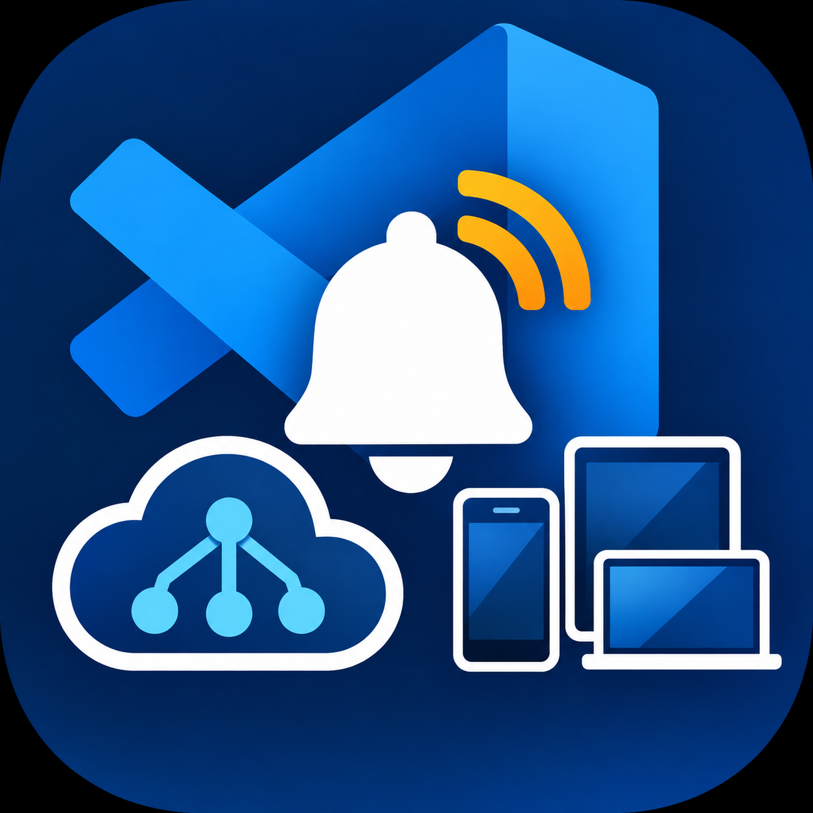

<p align="center">
  
</p>

<h1 align="center">Azure Notification Hub Explorer for VS Code</h1>

Browse device registrations, search them by tag, and send test notifications to an Azure Notification Hub from VS Code. It works like the old **Notification Hub Explorer** in Visual Studio (Server Explorer → Notification Hubs).

## Features

- **Hubs view** in the activity bar (bell icon). Add as many hubs as you like. Connection strings are kept in VS Code's encrypted SecretStorage.
- **Device Registrations** tab
  - Lists every registration with paging (**Load more**), or searches by **tag**. You can also click any tag chip to search for it.
  - Filter the loaded rows by text or platform, and sort by any column.
  - View the full registration JSON, **edit tags**, copy the PNS handle, delete one or several registrations, and export the list as JSON.
  - **Send** on a row opens Test Send ready to target that device's handle.
- **Test Send** tab
  - Platforms: Apple (APNS), FCM v1, FCM legacy, Windows (toast, tile, badge, raw), Template, ADM, Baidu, Xiaomi, and Browser.
  - Send to all devices, a **tag expression** (e.g. `user:123 || (sports && !scores)`), or a single **device handle**.
  - Each platform starts with a sample payload. You can add custom headers as JSON.
  - **Test send** mode returns the outcome for each registration (success, or why it failed) and delivers to at most 10 devices.
  - Every send is also logged to the *Notification Hub Explorer* output channel.


## Getting started

1. In the Azure portal, open your Notification Hub → **Access Policies** and copy a connection string.
   - Use `DefaultFullSharedAccessSignature` (Listen, Manage, Send) if you want to list, edit, or delete registrations.
   - `DefaultListenSharedAccessSignature` is **not** enough to send notifications or list registrations.
2. Click the bell icon → **Add Notification Hub**, then paste the connection string and enter the hub name.
3. Click the hub to open the explorer. Use the inline icons to jump straight to **Send Test Notification** or **Search Registrations by Tag**.

## Notes and limitations

- Tag search (`listRegistrationsByTag`) matches a **single tag exactly**. Tag *expressions* are only supported when sending.
- The tool works with *registrations*. *Installations* aren't listed, because the service has no API to enumerate them.
- Per-device outcomes are only returned for test sends. A direct send to a device handle can't be a test send.
- Setting: `notificationHubExplorer.registrationPageSize` (1–100, default 100).

## Development

```powershell
npm install
npm run build        # bundle with esbuild into dist/
npm run typecheck    # tsc --noEmit
npm run package      # produce a .vsix
```

Press **F5** to launch an Extension Development Host. To install the packaged extension, run `code --install-extension notification-hub-explorer-0.1.0.vsix`.
